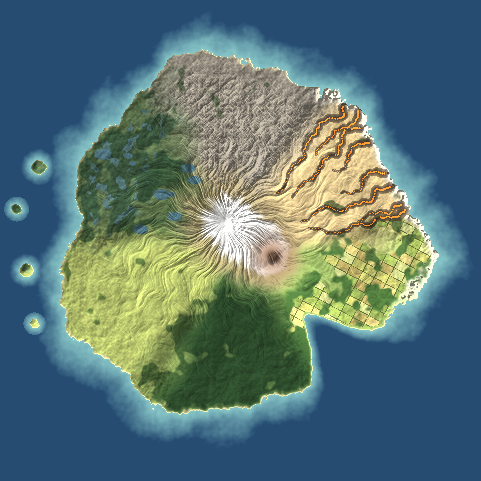

# WorldShard

An open-world fantasy game set on a broken chunk of Earth floating in space.
Thor's hammer broke the Earth apart; this shard is one of the pieces. It sits in
a half-sphere bowl of water (the **Rim Sea**) ringed by the **Cloudwall**, where
all of the island's weather is born. Mount Everest and Mount St. Helens stand in
the middle, and six regions with their own native peoples, nature and geography
spread out from their base. Content and items are player-driven.



## The six regions

| Region | Nature |
|---|---|
| North | Rock mines |
| Northeast | Lava flows and desert |
| Southeast | Mid forest with fields, and the inlet sea |
| South | Dark forest |
| Southwest | Grasslands |
| Northwest | Lakes and swampy forest |

Full world design: [docs/map-and-world.md](docs/map-and-world.md).

## Repository layout

| Path | What it is |
|---|---|
| `src/worldgen/` | **Rust** world generator — the island's shape, heights, region colours, lava flows and lakes. No dependencies. Produces exactly the same island as the design map and the web prototype. |
| `src/bin/mapgen.rs` | Builds the world and writes a shaded preview (`world_preview.ppm`) and a 16-bit heightmap (`world_height16.pgm`, value / 4 − 512 = metres). |
| `web-prototype/index.html` | The first playable version: a single-page WebGL 2 web app. Walk the island in first person on phone or desktop, swim, day/night cycle, Cloudwall barrier, compass, minimap and region banners. Reference for the Rust port. |
| `tools/island-map.html` | The illustrated top-down design map (canvas shaded relief) built from the same generator. |
| `docs/` | World design, free asset sources, prototype notes. |

## Running

```sh
# Rust world generator (about 0.2 s)
cargo run --release --bin mapgen

# Web prototype: open the file in a browser (needs WebGL 2)
open web-prototype/index.html
```

## Saving

Saves are small JSON files the player keeps wherever they like — the plan is
Google Drive, without any connector or API: the game offers the file through
the device's save / share menu, and loads it back through the file picker.
Format:

```json
{"game":"WorldShard","v":1,"x":0,"z":0,"yaw":0,"pitch":0,"hours":9,"day":1,"visited":["Southwest"],"playSec":0,"savedAt":0}
```

The web prototype also keeps a quick save in the browser (or the player's
account when run inside Claude).

## Status and next steps

- [x] World design, regions and map
- [x] Web prototype you can walk around
- [x] World generator ported to Rust (verified identical to the JS version)
- [ ] Choose the Rust engine (Bevy is the current pick) and build for the web with WebAssembly
- [ ] Port terrain, water, sky and walking to Rust
- [ ] Replace placeholder trees/rocks/mines with CC0 assets ([docs/3d-asset-sources.md](docs/3d-asset-sources.md))
- [ ] Native inhabitants, items and player-built content

Note: the save-file feature in `web-prototype/index.html` has not been tested yet.
